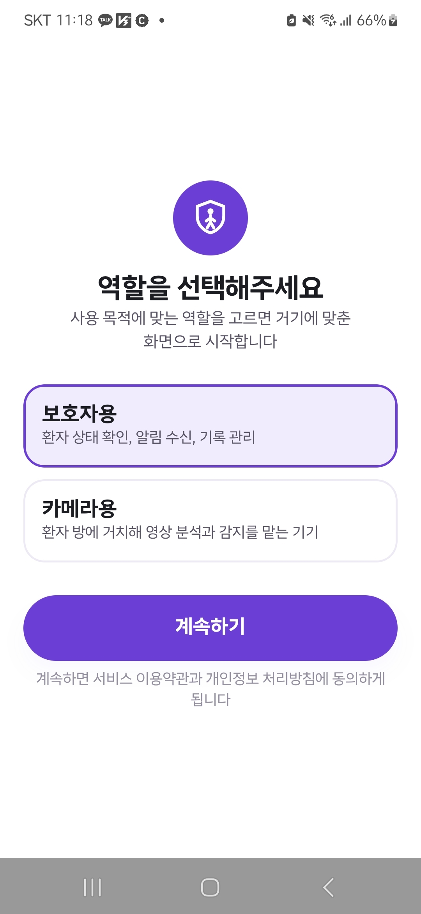
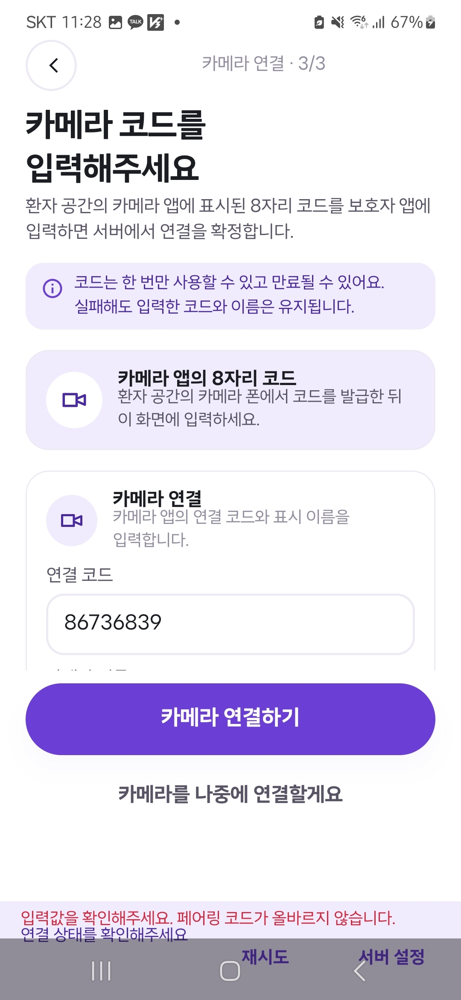
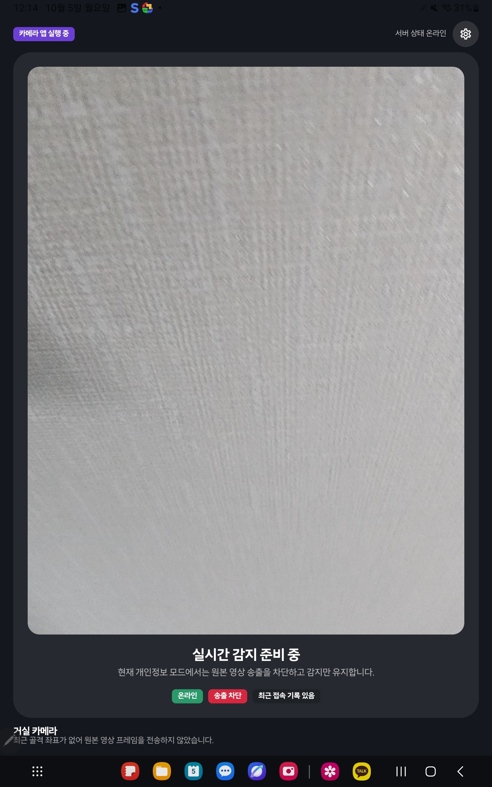
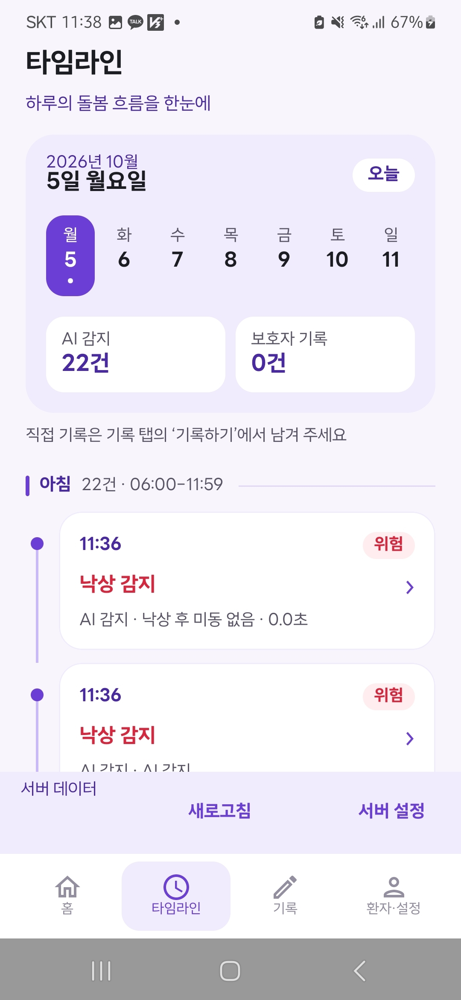
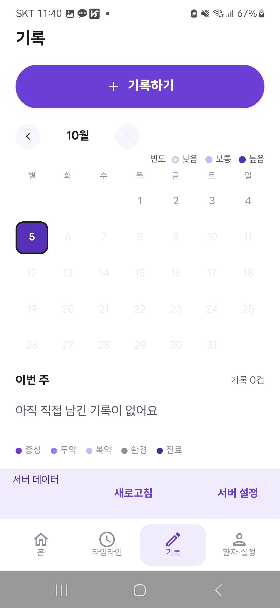
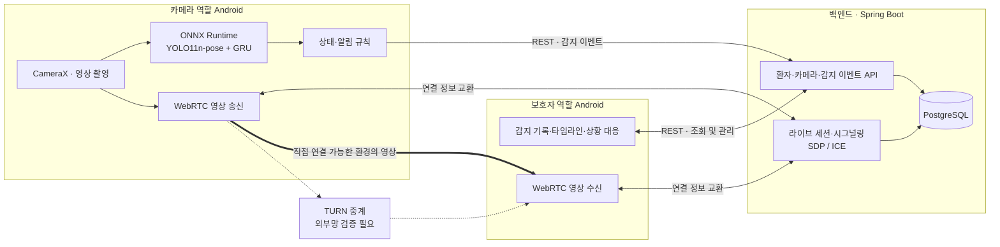
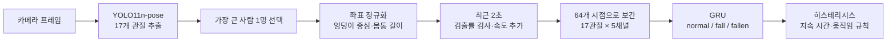

# CareGuard | 영상 기반 낙상 감지와 보호자 모니터링

**카메라 역할의 스마트폰이 낙상을 감지하고, 보호자가 앱에서 감지 기록과 실시간 영상을 확인하는 프로젝트입니다.**

치매환자·독거노인 돌봄 상황을 대상으로, 낙상 순간뿐 아니라 넘어진 상태가 지속되는 상황까지 감지하는 것을 목표로 합니다. 카메라 단말에서 AI 추론을 수행하고, 백엔드는 감지 이벤트와 영상 연결을 관리합니다.

> **현재 단계: 개발 중인 프로토타입 · 서버 배포 전**<br>
> 앱 화면, 단말 내 추론, 백엔드 API 및 라이브 연결 코드가 구현되어 있습니다. 실제 운영 환경의 장시간 감지 성능과 외부망 연결은 추가 검증이 필요합니다. 아래 화면과 실험 수치는 운영 서비스의 성능 보장을 의미하지 않습니다.

[앱 화면](#앱-화면) · [시스템 아키텍처](#시스템-아키텍처) · [ML 파이프라인](#ml-파이프라인) · [실험 결과](#실험-결과) · [실행 안내](#실행-안내)

## 주요 기능

| 사용자 흐름 | 내용 |
|---|---|
| 보호자 설정 | 환자 정보와 비상 연락처를 등록하고 관리 |
| 카메라 연결 | 카메라 단말에서 발급한 8자리 코드를 보호자 단말에 입력해 연결 |
| 낙상 감지 | 카메라 단말에서 관절을 추출하고 정상·낙상 중·넘어진 상태를 분류 |
| 실시간 확인 | 보호자 화면에서 WebRTC 영상 연결을 통해 현장을 확인 |
| 기록 확인 | AI 감지와 수동 기록을 일별 타임라인·월별 캘린더로 조회 |
| 상황 대응 | 긴급 상황 상세·현장 클립·연락 및 대응 기록을 위한 화면과 API 제공 |

푸시 알림(FCM)은 미구현입니다. 긴급 상황 관련 화면·API가 있다는 것과 실제 기기에서 감지부터 알림·대응까지 전 과정이 검증됐다는 것은 구분합니다.

## 앱 화면

제공된 앱 화면 문서에서 추출한 개발 단계 화면입니다. 테스트 값과 디버그 UI가 포함되어 있으며, 배포된 제품 화면이 아닙니다.

<table>
  <tr>
    <th>역할 선택</th>
    <th>카메라 연결</th>
    <th>카메라 단말</th>
  </tr>
  <tr>
    <td></td>
    <td></td>
    <td></td>
  </tr>
</table>

<table>
  <tr><th>일별 타임라인</th><th>월별 캘린더</th></tr>
  <tr>
    <td></td>
    <td></td>
  </tr>
</table>

환자·연락처 등록 → 카메라 연결 → 감지·영상 확인 → 기록 조회·대응으로 이어지는 흐름입니다. 상세 구현 범위는 [앱·백엔드 연결 문서](CareGuardCamera/BACKEND_CONNECTION.md)를 참고하세요.

## 시스템 아키텍처

배포 인프라가 아닌 **현재 코드의 역할과 통신 경계**를 나타냅니다. 서버 배포는 아직 진행하지 않았습니다.



### 설계 선택과 이유

| 설계 선택 | 설명 |
|---|---|
| **카메라 단말 내부에서 AI 추론 수행** | ONNX Runtime으로 YOLO와 GRU를 실행합니다. 관절의 시간적 변화를 분석하므로 낙상 판정을 위해 매 프레임을 서버에 전송할 필요가 없습니다. 대신 처리 성능은 단말 사양에 영향을 받습니다. |
| **감지 이벤트와 영상 전송 경로 분리** | 감지 이벤트는 REST API로, 실시간 영상은 WebRTC로 전달합니다. 보호자의 영상 시청과 별개로 감지·이벤트 기록을 수행하도록 구성했습니다. |
| **연결 제어와 영상 전달 분리** | Spring Boot는 세션과 SDP·ICE 교환을 담당하고, 실제 영상은 WebRTC 경로로 전달합니다. 직접 연결이 어려운 환경에서는 TURN 중계가 필요할 수 있습니다. |
| **카메라와 보호자 역할 분리** | 지속적인 촬영·감지는 카메라 단말이, 결과 조회·영상 확인은 보호자 단말이 담당합니다. 보호자 화면 조작과 카메라의 감지 흐름을 분리했습니다. |

## ML 파이프라인



| 항목 | 현재 구성 |
|---|---|
| 관절 추출 | 사전학습 YOLO11n-pose, COCO 17관절 |
| 입력 특징 | 관절별 `(x, y, 신뢰도, vx, vy)`; 속도는 정규화 좌표의 변화율 |
| 모델 입력 | 최근 2초를 64개 시점으로 보간; Android 텐서 `[1, 64, 85]` |
| 분류 모델 | GRU 2층, 은닉 크기 128, 파라미터 182,019개 |
| 출력 클래스 | `normal` 정상 / `fall` 넘어지는 중 / `fallen` 넘어진 상태 |
| 추론 간격 | 약 0.5초; Android에서는 실제 촬영 타임스탬프 사용 |
| 품질 검사 | 구간 내 검출률 50% 미만이면 GRU 생략, `no_person` |
| 상태 안정화 | `P(fall) + P(fallen) > 0.5`이면 위험 진입, `≤ 0.35`이면 해제 |

정규화는 화면 속 위치와 몸 크기의 영향을 줄이는 처리입니다. 카메라 각도나 가림까지 제거하지는 않습니다. 또한 보간은 입력 크기를 통일하며, 서로 다른 FPS 영상의 예측 결과까지 같게 만들지는 않습니다.

### 분류 결과를 이벤트로 바꾸는 규칙

| 이벤트 | 조건 |
|---|---|
| `FALL` | `fall` 상태에 진입; 재발화 제한 적용 |
| `FALLEN_IMMOBILE` · R1 | `fall` 또는 `fallen` 상태가 3초 연속 유지 |
| `STILL_HORIZONTAL` · R2 | 몸통 수평과 작은 움직임 조건이 5초 유지 |

R1은 이름과 달리 움직임을 직접 검사하지 않고 **위험 상태의 지속 시간**을 검사합니다. 움직임을 직접 확인하는 규칙은 R2입니다. 이 임계값들은 현재 프로토타입 설정이며 실환경 검증을 통해 조정할 대상입니다.

Python 데모의 가로 960픽셀 축소·FPS 기반 처리와 Android의 640×640 Letterbox·타임스탬프 기반 처리는 구분합니다. 구현은 [공통 모델 정의](scripts/pipeline_core.py), [Python 데모](scripts/realtime_demo.py), [Android 추론 엔진](CareGuardCamera/app/src/main/java/com/example/careguardcamera/inference/TimestampedFallModelEngine.kt)에서 확인할 수 있습니다.

## 실험 결과

아래는 저장된 실험 기록이며, 앱 전체의 운영 성능을 측정한 결과는 아닙니다. **클립 분류, 영상 내 낙상 포착, 지속 알림은 서로 다른 지표**입니다.

### 현재 기본 모델: GRU v1 · 좌표 + 속도

| 평가 조건 | 지표 | 기록된 결과 |
|---|---|---|
| OmniFall 피험자 단위 5-fold | 위험(fall + fallen) Recall / FPR | **0.860 ± 0.026 / 0.131 ± 0.077** |
| AI Hub 낙상 24영상 | 영상 단위 낙상 Recall | **0.917** |
| AI Hub 비낙상 8영상 | 위험 판정 윈도우 비율 | **0.162**; 좌표만 사용 시 0.346 |
| URFD 낙상 30영상 · 학습 미사용 외부셋 | 영상 단위 낙상 Recall | **0.867** |
| URFD 일상 40영상 | R1 오경보가 발생한 영상 수 | **3 / 40** |

AI Hub 32영상은 독립적인 32장면이 아니라 **4장면 × 8카메라**입니다. 영상 단위 Recall은 낙상 순간의 포착을 나타내며, 이후 넘어진 상태의 지속 감지까지 보장하지 않습니다.

출처: [속도 특징 비교](docs/results_velocity.md) · [데이터 확장·외부 평가](docs/results_data_expansion.md)

### 실험으로 남긴 판단

| 시도 | 관찰 결과 | 현재 선택 |
|---|---|---|
| 좌표에 속도 특징 추가 | AI Hub 비낙상 위험 윈도우 비율이 0.346 → 0.162로 감소 | `posvel` 입력 사용 |
| 학습 데이터 확장: 약 1,194 → 6,223클립 | v4의 URFD 낙상 Recall은 1.000으로 증가했지만 일상 R1 오경보도 3/40 → 11/40으로 증가 | 기본 모델은 v1 유지 |
| 합성 누움 데이터 추가 | v5b의 일부 오경보가 줄었지만, AI Hub 낙상 후 위험 유지율도 v1 0.43 → 0.23으로 감소 | v5b는 실험 모델로 보관 |
| FALL 이후에만 R1 허용 | 정상적으로 눕는 장면에서도 FALL이 먼저 발생해 오경보가 해결되지 않음 | 기존 규칙 유지, 공간 정보 추가 검토 |

**클립 성능이나 낙상 Recall 하나만으로 모델을 교체하지 않고, 낙상 후 유지율과 일상 오경보를 함께 비교합니다.** 규칙 실험은 [R1 변형 결과](docs/results_rules.md)에 기록되어 있습니다.

### 데이터와 재현 범위

- 기본 학습: OmniFall의 GMDCSA24·edf·caucafall, 약 1,194클립·피험자 19명. 초기 정제 실험은 1,193클립으로 기록되어 있으므로 실험 버전을 구분합니다.
- 후속 실험: UP_Fall·LE2I·MCFD·OCCU 및 OF-Synthetic 추가 평가를 진행했습니다.
- 같은 피험자가 학습·평가에 섞이지 않도록 피험자 단위로 분할하고, 데이터셋 하나를 제외하는 환경 일반화 평가도 수행했습니다.
- 데이터셋과 원본 영상은 저장소에 포함하지 않습니다. 이용·재배포 조건은 데이터셋마다 다르므로 [데이터 레지스트리](configs/datasets.yaml)를 참고하고 실제 활용 전 원본 조건을 확인해야 합니다.

## 기술 스택

| 영역 | 기술 |
|---|---|
| Android | Kotlin, Jetpack Compose, CameraX, ONNX Runtime, WebRTC |
| ML 학습·평가 | Python, PyTorch, Ultralytics YOLO, NumPy, OpenCV |
| 백엔드 | Java 17, Spring Boot, Spring Data JPA |
| 데이터 저장 | PostgreSQL |

## 현재 한계와 다음 작업

- **정상 누움과 낙상의 혼동:** 관절 좌표·속도만으로 침대와 바닥의 맥락을 구분하기 어렵습니다. 침대 ROI·바닥 위치 등 공간 정보가 개선 후보입니다.
- **단일 인물 선택:** 가장 큰 박스를 선택하며 동일 인물을 추적하지 않습니다. 여러 사람이 등장하면 대상이 바뀔 수 있습니다.
- **장시간·외부망 검증:** 짧은 영상 실험을 장시간 운영 성능으로 일반화할 수 없습니다. 실제 단말 2대, 외부망 WebRTC·TURN, 발열·배터리·프레임 누락 검증이 필요합니다.
- **출시 기능:** 보호자 인증·환자별 접근 권한·HTTPS·FCM 등 운영 기능을 완성해야 합니다. 개발용 카메라 토큰 및 라이브 접근 제한은 서비스 인증을 대체하지 않습니다.
- **앱 경로 정리:** 실제 ONNX 추론을 사용하는 `CameraLiveScreen`과, 관절 추출 스텁이 남은 레거시 `PoseAnalyzer` 경로가 공존합니다.

## 실행 안내

### Android와 백엔드

1. Java 17과 PostgreSQL을 준비하고 [백엔드 실행 안내](fall_detection_backend/README.md)에 따라 초기 스키마와 접속 설정을 구성합니다.
2. `fall_detection_backend/`에서 `./gradlew bootRun`으로 서버를 실행합니다.
3. Android Studio에서 `CareGuardCamera/`를 열고 SDK·Gradle 환경을 준비합니다.
4. [앱 연결 안내](CareGuardCamera/BACKEND_CONNECTION.md)에 따라 서버 주소를 설정합니다. 에뮬레이터 기본값은 `http://10.0.2.2:8080`입니다.
5. 카메라 역할에서 연결 코드를 발급하고, 보호자 역할에서 코드를 입력합니다. 라이브 기능 설정은 [실시간 MVP 안내](CareGuardCamera/LIVE_VIDEO_MVP.md)를 따릅니다.

### Python 영상 데모

```bash
python3.11 -m venv venv
source venv/bin/activate
pip install -r requirements.txt
python scripts/realtime_demo.py --source /path/to/video.mp4
```

데모에는 입력 영상과 YOLO pose 가중치가 필요합니다. GRU 체크포인트는 `models/gru.pt`, Android용 ONNX 모델과 명세는 앱의 `assets/`에 포함되어 있습니다. 자세한 데이터 준비·학습·평가 명령은 [ML 실행 가이드](docs/how_to_run.md)를 참고하세요.

### 검증 기록과 명령

2026-11-04 로컬 검사에서 모델 파일 해시 검증과 PyTorch ↔ ONNX 비교가 통과했습니다. 비교 입력 2개의 최대 logit 차이는 약 `4.2 × 10⁻⁷`입니다. 이는 변환 모델의 수치 일치 검사이며 실제 영상에서의 정확도 검증은 아닙니다.

```bash
python scripts/live_model_parity.py --compare-gru
```

앱·백엔드의 단계별 과거 검증 범위와 실행 명령은 [앱 연결 문서](CareGuardCamera/BACKEND_CONNECTION.md) 및 [실시간 MVP 문서](CareGuardCamera/LIVE_VIDEO_MVP.md)에 남겨 두었습니다. 이번 README 정리에서 전체 앱·백엔드 테스트를 재실행하지는 않았습니다.

## 저장소 구성과 상세 기록

```text
CareGuardCamera/          Android 보호자·카메라 앱 및 ONNX 모델
fall_detection_backend/  Spring Boot API
scripts/                 관절 추출·학습·평가·데모·모델 검증
models/                  GRU 기본 모델과 비교용 체크포인트
tests/                   Python 모델 계약·일치성 테스트
docs/                    실험 결과·설계·실행 가이드·앱 화면
configs/                 데이터셋 레지스트리
ML_RESEARCH.md           기존 ML 중심 README 보존본
```

- [ML 연구 기록과 기존 데모 결과](ML_RESEARCH.md) — 이전 README를 보존한 문서로, 데이터 확보 상태 등 일부 내용은 당시 기준입니다.
- [모델 비교·피험자 교차검증](docs/results_final.md)
- [속도 특징 도입 결과](docs/results_velocity.md)
- [데이터 확장과 기본 모델 유지 근거](docs/results_data_expansion.md)
- [알림 규칙 실험](docs/results_rules.md)
- [백엔드 설계](docs/backend/backend-design.md)
- [남은 ML 이슈](docs/ISSUES.md)

이 README는 공유된 모델 정리·앱 화면·아키텍처 문서를 바탕으로 구성하고, 현재 코드와 후속 실험 기록에 맞춰 상태를 구분했습니다. 원본 PDF의 과거 계획을 현재의 미구현 항목으로 그대로 옮기지 않았습니다.
