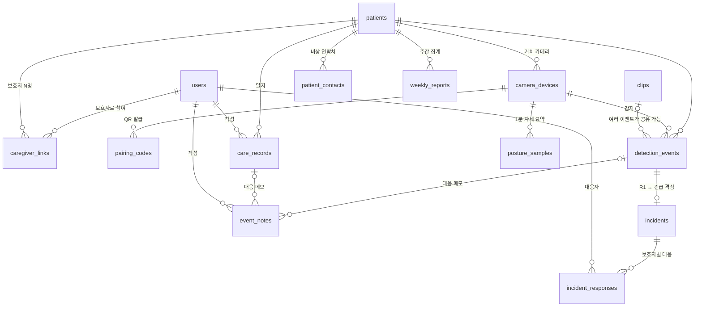

# CareGuard 백엔드 설계서 — 엔티티 · 테이블 · 전송 흐름

_작성 2026-10-02 · 스택: Spring Boot 3 + Spring Data JPA + PostgreSQL 15+ · DDL 원본: `schema.sql`_

이 문서 하나로 백엔드 작업을 시작할 수 있도록 엔티티 관계, 테이블 컬럼, 열거형, 카메라 폰 ↔ 서버 흐름, 프로젝트 의존성을 모았다.

---

## 확정된 화면·저장 계약 (2026-10-02)

- 엔티티는 기존 12개 + `PatientContact` + `EventNote`의 14개다. 카메라 재연결 표시와 `DeviceStatusHistory`는 이번 범위에서 제외한다.
- `CareRecord`는 기록 탭에서 보호자가 입력하는, AI가 탐지하지 못한 환자 이상상황이다. 타임라인에 표시하고 상세에서 대응 메모를 여러 개 누적한다. 원본 이상상황 기록과 후속 대응 메모는 구분한다.
- `EventNote`는 `detection_event_id` 또는 `care_record_id` 중 정확히 하나를 참조한다. 두 nullable FK와 XOR CHECK로 고아 대상/이중 대상을 금지한다. 작성자·대응 종류·선택 환자 상태·본문·작성 시각을 저장한다. 다른 보호자에게 알리는 기능은 제외한다. 대상 환자에 대한 작성자 접근 권한은 서비스에서 검증한다.
- `PatientContact`는 환자별 이름·관계·전화번호를 저장한다. 비가입 가족도 등록하며 로그인 계정이나 앱 접근 권한을 생성하지 않는다. 온보딩에서 최초 등록하고 설정 > 보호자 관리에서 추가·수정한다. `User` 및 `CaregiverLink`는 가입 보호자의 계정·접근 관계를 계속 담당한다.
- 환자는 프론트에 맞춰 `age`(0~130)를 저장한다. `birth_date`를 나이로 추정하지 않으며 자동으로 나이를 증가시키지 않는다.
- 캘린더는 환자별 하루 AI 이상현상 건수 + `CareRecord` 건수로 계산한다. 대응 메모 수, 정상/기상 파생 행은 제외한다. 0건은 색상 없음, 1~2건은 연한 보라, 3~5건은 중간 보라, 6건 이상은 진한 보라다. 이는 의료적 위험도가 아닌 이상현상 기록 빈도다.
- 초기 집계 날짜는 Asia/Seoul 기준으로 AI의 `occurred_at`, 수동 기록의 `recorded_at`(상황 발생 시각)을 사용한다. `created_at`은 작성 시각이다. 원본 행을 각각 집계한 뒤 합산하여 대응 메모 JOIN으로 건수가 늘어나지 않게 한다. 별도 캘린더/타임라인 엔티티는 추가하지 않는다.
- 후속 프론트 작업: 수동 기록 상세에도 대응 메모 연결, 비상 연락처 입력을 온보딩·보호자 관리로 통합, 재연결 샘플 제거, 캘린더 실제 빈도 집계 및 범례 적용. 현재 화면 구현이 이 계약을 모두 만족한다는 의미는 아니다.
- 미확정 보존 정책: 영상의 보존 기한을 영상 없는 수동 기록·대응 메모에 자동 적용하지 않는다. 삭제 정책은 별도 확정한다.

## 1. 전체 그림



| 구역 | 테이블 | 한 줄 요약 |
|---|---|---|
| 계정·환자 | `users` | 로그인 계정 = 보호자 |
| | `patients` | 돌봄 대상 |
| | `caregiver_links` | users ↔ patients 다대다. 관계·역할·알림 설정의 주인 |
| 기기 | `camera_devices` | 거치 폰. 하트비트 상태, 영상 공개 모드, 민감도 |
| | `pairing_codes` | QR 1회용 코드 |
| 감지·긴급 | `detection_events` | 규칙 발화 1건 = 1행 |
| | `clips` | 영상 포인터 (바이트는 S3/MinIO) |
| | `incidents` | 긴급 상황 (10초 카운트다운, 종료 사유) |
| | `incident_responses` | 보호자별 대응 상태 |
| 자세 요약 | `posture_samples` | 1분 단위 자세 집계 |
| 기록·리포트 | `care_records` | 보호자 일지 |
| | `weekly_reports` | 주간 집계 스냅샷 |

### 설계 원칙

- 보호자는 별도 엔티티가 아니라 **users + caregiver_links**. 한 사람이 환자 둘의 보호자가 될 수 있고, 관계(자녀·배우자)는 "그 환자에 대한" 속성이다.
- **detection_events 와 incidents 를 분리**. 감지는 하루 수십 건, 긴급은 드물고 대응 이력이 붙는다.
- **camera_devices 는 patients 아래**. 카메라는 환자 방에 속하지 보호자에 속하지 않는다.
- **clips 는 포인터 테이블**. 바이너리 컬럼 없음.
- 0.5초 단위 모델 상태는 서버에 저장하지 않는다. 1분 요약(`posture_samples`)만 받는다.
- PK 는 전부 `uuid`. 시간은 `timestamptz`. 키포인트는 `jsonb`.

---

## 2. 모델 출력과 전송 흐름

카메라 폰 안에서 YOLO11n-pose → GRU 가 **0.5초마다** 상태(`normal / fall / fallen / no_person`)와 확률 3개를 낸다. 규칙(ImmobilityDetector)이 그 시계열을 보다가 조건이 맞는 순간만 이벤트를 낸다.

| 이벤트 | 조건 | 재발화 |
|---|---|---|
| `FALL` | 상태가 `fall` 로 바뀌는 순간 | 2초 쿨다운 |
| `FALLEN_IMMOBILE` (R1) | `fall/fallen` 3초 이상 지속 | 상태가 풀릴 때까지 없음 |
| `STILL_HORIZONTAL` (R2) | 몸통 수평 + 움직임 없음 5초 지속 | 상태가 풀릴 때까지 없음 |

### 카메라 폰 → 서버 메시지 3종

**① 이벤트** — 규칙 발화 시 즉시, REST

```
POST /api/devices/{deviceId}/events
Authorization: Device {device_token}
{
  "clientEventId": "uuid",            // 폰 생성. 재전송 중복 방지
  "occurredAt": "2026-10-28T18:00:04+09:00",
  "kind": "FALLEN_IMMOBILE",          // FALL | FALLEN_IMMOBILE | STILL_HORIZONTAL
  "rule": "R1",                       // MODEL | R1 | R2
  "state": "FALLEN",
  "prob": [0.04, 0.31, 0.65],         // normal, fall, fallen
  "durationSec": 3.2,
  "keypoints": [[x, y, conf] × 17],   // 발화 프레임 1장
  "clip": { "wantsUpload": true, "durationSec": 20 }
}
→ 201 { "eventId", "incidentId"?, "clipUploadUrl"? }
```

서버 처리: `detection_events` insert → `kind == FALLEN_IMMOBILE` 이면 `incidents` 생성 + 10초 타이머 → `clip.wantsUpload` 면 `clips(UPLOADING)` 행 + presigned 업로드 URL 반환.

**② 자세 요약** — 1분 배치, REST

```
POST /api/devices/{deviceId}/samples
[{ "minuteAt": "2026-10-28T02:13:00+09:00",
   "dominant": "LYING",               // UPRIGHT | LYING | ABSENT
   "lyingRatio": 0.97, "motion": 0.01, "detectRate": 0.9, "fps": 9.8 }]
```

`posture_samples` upsert. 지난밤 요약·활동 시간·주간 리포트의 원천.

**③ 하트비트** — 30초, REST (후에 WebSocket 전환 가능)

```
POST /api/devices/{deviceId}/heartbeat
{ "fps": 9.8, "batteryPct": 100, "isCharging": true, "thermalOk": true, "privacyMode": "VIDEO_SKELETON" }
```

`camera_devices` 컬럼만 갱신. 서버 스케줄러가 `last_seen_at` 2분 초과 기기를 `OFFLINE` 으로 바꾸고 보호자에게 알린다.

### 긴급 흐름

1. R1 이벤트 → `incidents` 생성(`countdown_ends_at = started_at + 10s`), 보호자 전원에 `incident_responses(NOTIFIED)` 생성
2. 카운트다운 중 환자가 "괜찮습니다" → 폰이 `PATCH /api/incidents/{id}` `{ "patientResponded": true }` → 타이머 취소, `resolution = PATIENT_OK`
3. 응답 없이 만료 → FCM 발송, `auto_notified_at` 기록
4. 보호자 앱: 배너 "내가 대응할게요" → `incident_responses.status = RESPONDING`; "상황 종료" → `incidents.resolved_at`, `resolution`

### 클립 저장

1. 이벤트 POST 응답의 presigned URL 로 폰이 mp4 를 스토리지에 직접 업로드 (Spring 을 거치지 않음)
2. 폰이 `POST /api/clips/{id}/complete` → `status = READY`
3. 보호자 앱이 이벤트 상세 요청 → 서버가 몇 분짜리 presigned 다운로드 URL 반환
4. `expires_at` 지난 행은 야간 배치가 오브젝트 삭제 후 `DELETED`

---

## 3. 열거형

| 타입 | 값 |
|---|---|
| `caregiver_role` | OWNER, MEMBER |
| `caregiver_relation` | CHILD, SPOUSE, SIBLING, RELATIVE, ACQUAINTANCE, OTHER |
| `privacy_mode` | VIDEO_SKELETON, SKELETON_ONLY, NO_OVERLAY |
| `device_status` | ONLINE, OFFLINE, UNPAIRED |
| `event_kind` | FALL, FALLEN_IMMOBILE, STILL_HORIZONTAL |
| `event_rule` | MODEL, R1, R2 |
| `pose_state` | NORMAL, FALL, FALLEN, NO_PERSON |
| `review_label` | CONFIRMED, FALSE_POSITIVE |
| `posture` | UPRIGHT, LYING, ABSENT |
| `clip_status` | UPLOADING, READY, DELETED |
| `incident_resolution` | PATIENT_OK, CAREGIVER_OK, EMERGENCY_CALL, FALSE_POSITIVE |
| `response_status` | NOTIFIED, ACKNOWLEDGED, RESPONDING |
| `record_category` | SYMPTOM, MEDICATION, DOSE, ENVIRONMENT, VISIT, OTHER |
| `condition_level` | NORMAL, SLIGHTLY_UNSTABLE, DIZZY, GAIT, APPETITE, SLEEP, MEMORY, FALL |

JPA 매핑: `@Enumerated(EnumType.STRING)` + `@JdbcTypeCode(SqlTypes.NAMED_ENUM)` (Hibernate 6.2+).

---

## 4. 테이블 상세

### users — 보호자 계정

| 컬럼 | 타입 | 제약 | 설명 |
|---|---|---|---|
| id | uuid | PK, default gen_random_uuid() | |
| email | varchar(255) | NOT NULL, UNIQUE | 로그인 ID |
| phone | varchar(32) | | |
| password_hash | varchar(255) | NOT NULL | BCrypt |
| name | varchar(60) | NOT NULL | |
| fcm_token | varchar(512) | | 푸시 대상 토큰 (기기 1대 전제) |
| created_at / updated_at | timestamptz | NOT NULL | 트리거로 updated_at 갱신 |

### patients — 돌봄 대상

| 컬럼 | 타입 | 제약 | 설명 |
|---|---|---|---|
| id | uuid | PK | |
| name | varchar(60) | NOT NULL | |
| age | smallint | CHECK 0..130 | 보호자가 입력한 나이 |
| sex | char(1) | CHECK in ('M','F') | |
| address | varchar(255) | | 119 신고용. 긴급 화면 노출 |
| dementia_stage | varchar(40) | | 진단 여부·단계 (자유 입력) |
| created_at / updated_at | timestamptz | NOT NULL | |

### caregiver_links — 보호자 ↔ 환자

| 컬럼 | 타입 | 제약 | 설명 |
|---|---|---|---|
| id | uuid | PK | |
| user_id | uuid | FK users ON DELETE CASCADE | |
| patient_id | uuid | FK patients ON DELETE CASCADE | |
| relation | caregiver_relation | NOT NULL | 자녀·배우자… |
| role | caregiver_role | NOT NULL default MEMBER | OWNER 는 환자 정보 수정·보호자 초대 가능 |
| notify_fall | boolean | default true | 낙상 알림 |
| notify_still_min | smallint | | 미동(R2) 알림 기준 분. null = 끔 |
| notify_offline | boolean | default true | 카메라 연결 끊김 알림 |
| joined_at | timestamptz | NOT NULL | |
| | | UNIQUE (user_id, patient_id) | |
| | | INDEX (patient_id) | |

### camera_devices — 거치 폰

| 컬럼 | 타입 | 제약 | 설명 |
|---|---|---|---|
| id | uuid | PK | |
| patient_id | uuid | FK patients ON DELETE SET NULL | 페어링 전 null |
| name | varchar(60) | NOT NULL default '거실 카메라' | |
| model | varchar(80) | | 'Galaxy A35' |
| device_token | varchar(255) | NOT NULL, UNIQUE | 카메라 폰 인증. 페어링 시 발급 |
| privacy_mode | privacy_mode | default VIDEO_SKELETON | 라이브 화면 모드 |
| sensitivity | smallint | CHECK 1..3, default 2 | 감지 민감도 |
| status | device_status | default UNPAIRED | |
| last_seen_at | timestamptz | INDEX | 하트비트. 2분 초과 → OFFLINE |
| last_fps | real | | |
| battery_pct | smallint | | |
| is_charging | boolean | | |
| thermal_ok | boolean | | |
| paired_at | timestamptz | | |
| created_at | timestamptz | NOT NULL | |
| | | INDEX (patient_id) | |

### pairing_codes — QR 1회용 코드

| 컬럼 | 타입 | 제약 | 설명 |
|---|---|---|---|
| id | uuid | PK | |
| camera_device_id | uuid | FK camera_devices ON DELETE CASCADE | |
| code | varchar(16) | NOT NULL, UNIQUE | QR 내용 |
| expires_at | timestamptz | NOT NULL | 발급 후 10분 권장 |
| used_at | timestamptz | | |
| used_by_user_id | uuid | FK users | 스캔한 보호자 |
| created_at | timestamptz | NOT NULL | |

### clips — 영상 포인터

| 컬럼 | 타입 | 제약 | 설명 |
|---|---|---|---|
| id | uuid | PK | |
| camera_device_id | uuid | FK camera_devices ON DELETE CASCADE | |
| storage_key | varchar(512) | NOT NULL, UNIQUE | `clips/{patient_id}/{event_id}.mp4` |
| thumbnail_key | varchar(512) | | 타임라인 썸네일 |
| status | clip_status | default UPLOADING | |
| started_at | timestamptz | NOT NULL | |
| duration_sec | real | | |
| size_bytes | bigint | | |
| mime_type | varchar(60) | default 'video/mp4' | |
| expires_at | timestamptz | NOT NULL | 보존 기한. 부분 인덱스 (status <> DELETED) |
| created_at | timestamptz | NOT NULL | |

### detection_events — 규칙 발화 이벤트

| 컬럼 | 타입 | 제약 | 설명 |
|---|---|---|---|
| id | uuid | PK | |
| client_event_id | uuid | NOT NULL, UNIQUE | 폰 생성. 멱등 키 |
| patient_id | uuid | FK patients ON DELETE CASCADE | |
| camera_device_id | uuid | FK camera_devices ON DELETE CASCADE | |
| occurred_at | timestamptz | NOT NULL | |
| kind | event_kind | NOT NULL | |
| rule | event_rule | NOT NULL | |
| state | pose_state | NOT NULL | 발화 시점 모델 상태 |
| prob_normal / prob_fall / prob_fallen | real | NOT NULL, CHECK 0..1 | |
| duration_sec | real | | R1·R2 지속 시간 |
| keypoints | jsonb | | `[[x,y,conf]×17]` 발화 프레임 1장 |
| clip_id | uuid | FK clips ON DELETE SET NULL | |
| reviewed_as | review_label | | 보호자의 "오탐으로 표시". 재학습 데이터 |
| reviewed_by_user_id | uuid | FK users | |
| reviewed_at | timestamptz | | |
| created_at | timestamptz | NOT NULL | |
| | | INDEX (patient_id, occurred_at DESC) | 타임라인 조회 |
| | | INDEX (camera_device_id, occurred_at DESC) | |

### incidents — 긴급 상황

| 컬럼 | 타입 | 제약 | 설명 |
|---|---|---|---|
| id | uuid | PK | |
| detection_event_id | uuid | NOT NULL, UNIQUE, FK ON DELETE CASCADE | R1 이벤트 1건당 최대 1개 |
| patient_id | uuid | FK patients ON DELETE CASCADE | |
| started_at | timestamptz | NOT NULL | |
| countdown_ends_at | timestamptz | NOT NULL | started_at + 10초 |
| patient_responded | boolean | default false | "괜찮습니다" |
| patient_responded_at | timestamptz | | |
| auto_notified_at | timestamptz | | 만료 후 FCM 발송 시각 |
| resolved_at | timestamptz | | |
| resolution | incident_resolution | | |
| resolved_by_user_id | uuid | FK users | |
| resolution_note | text | | "혼자 일어나셨고 통증 없음" |
| created_at | timestamptz | NOT NULL | |
| | | 부분 INDEX (patient_id) WHERE resolved_at IS NULL | 진행 중 조회 |

### incident_responses — 보호자별 대응

| 컬럼 | 타입 | 제약 | 설명 |
|---|---|---|---|
| id | uuid | PK | |
| incident_id | uuid | FK incidents ON DELETE CASCADE | |
| user_id | uuid | FK users ON DELETE CASCADE | |
| status | response_status | default NOTIFIED | NOTIFIED → ACKNOWLEDGED → RESPONDING |
| notified_at | timestamptz | NOT NULL | |
| updated_at | timestamptz | NOT NULL | 트리거 |
| note | text | | |
| | | UNIQUE (incident_id, user_id) | |

### posture_samples — 1분 자세 요약

| 컬럼 | 타입 | 제약 | 설명 |
|---|---|---|---|
| camera_device_id | uuid | PK(복합), FK ON DELETE CASCADE | |
| minute_at | timestamptz | PK(복합) | 분 단위 절삭 |
| dominant | posture | NOT NULL | 그 1분의 대표 자세 |
| lying_ratio | real | CHECK 0..1 | 누움 비율 |
| motion | real | NOT NULL | 평균 관절 변위 (몸통 길이 단위) |
| detect_rate | real | CHECK 0..1 | 사람 검출 비율 |
| fps | real | | |

하루 1,440행, 1년 약 50만 행. 파티션 없이 시작.

### care_records — 보호자 일지

| 컬럼 | 타입 | 제약 | 설명 |
|---|---|---|---|
| id | uuid | PK | |
| patient_id | uuid | FK patients ON DELETE CASCADE | |
| author_user_id | uuid | FK users | |
| recorded_at | timestamptz | NOT NULL | |
| category | record_category | NOT NULL | 증상·투약·복약·환경·진료·기타 |
| condition | condition_level | | "오늘 상태" 칩 |
| title | varchar(80) | NOT NULL | |
| memo | text | | |
| created_at / updated_at | timestamptz | NOT NULL | |
| | | INDEX (patient_id, recorded_at DESC) | |

캘린더는 일별 AI 이상현상 + 수동 이상상황 기록 건수로 집계한다. 대응 메모는 제외하며 0건/1~2건/3~5건/6건 이상으로 표시한다. 별도 테이블 없음.

### weekly_reports — 주간 집계

| 컬럼 | 타입 | 제약 | 설명 |
|---|---|---|---|
| id | uuid | PK | |
| patient_id | uuid | FK patients ON DELETE CASCADE | |
| week_start | date | NOT NULL | 월요일 |
| abnormal_count | int | | FALL + STILL 수 |
| fall_count | int | | R1 기준 |
| uptime_percent | real | | 카메라 ONLINE 비율 |
| avg_active_hours | real | | posture_samples UPRIGHT 분 / 60 |
| avg_lying_night_hours | real | | |
| summary_text | text | | 자연어 한 줄 |
| pdf_key | varchar(512) | | 스토리지 포인터 |
| generated_at | timestamptz | NOT NULL | |
| | | UNIQUE (patient_id, week_start) | |

---

## 5. 일부러 뺀 것

- 알림 발송 로그 테이블: `incident_responses.NOTIFIED` 로 충분
- 설정 테이블: `caregiver_links.notify_*`, `camera_devices.privacy_mode` 로 흡수
- 오늘 상태 입력·진료 여부 화면: `care_records.category` 로 흡수
- 타임라인의 "기상", "활동 정상" 행: `posture_samples`에서 계산하는 파생 행. 카메라 재연결 이력은 범위 제외.

---

## 6. 프로젝트 의존성 (Spring Initializr)

| 의존성 | 용도 | 필수 |
|---|---|---|
| Spring Web | REST API | ✓ |
| Spring Data JPA | 엔티티·리포지토리 | ✓ |
| PostgreSQL Driver | | ✓ |
| Lombok | | ✓ |
| **Flyway Migration** | `schema.sql` → `V1__init.sql`. ddl-auto 금지 (enum·부분 인덱스 유지) | ✓ |
| **Validation** | 폰 JSON 검증 | ✓ |
| **Spring Security** | 보호자 JWT + 카메라 `device_token` 두 경로 | ✓ |
| Spring Boot Actuator | 헬스체크 | 권장 |
| Docker Compose Support | Postgres + MinIO 자동 기동 | 권장 |
| Testcontainers | 실제 Postgres 로 리포지토리 테스트 (H2 는 enum 불가) | 권장 |

Gradle 직접 추가: `software.amazon.awssdk:s3` (presigned URL, MinIO 호환), `com.google.firebase:firebase-admin` (FCM), JWT 라이브러리 (`jjwt` 또는 `spring-boot-starter-oauth2-resource-server`).

---

## 7. 검증 기록

기존 12개 테이블 버전: 2026-10-02 로컬 PostgreSQL 16 임시 클러스터에서 `schema.sql` 적용 → 테이블 12개 생성, users → patients → caregiver_links → camera_devices → detection_events → incidents → incident_responses → posture_samples → care_records 연쇄 insert 성공, `updated_at` 트리거 동작 확인.

## 8. 안드로이드 쪽 후속

현재 `ImmobilityDetector.kt` 에는 파이썬 데모의 `FALL` 상승 에지 이벤트와 R2 의 "움직임 없음(motion_energy)" 조건이 빠져 있다. 서버가 받는 이벤트 3종과 맞추려면 카메라 앱 구현 때 보완한다.

## 확정안 DDL 검증 (2026-10-02)

PostgreSQL 16 임시 클러스터에 수정한 schema.sql 적용 성공: 테이블 14개. 비가입 가족 연락처 저장, 수동 이상상황 한 건에 대응 메모 2개 저장 성공. 대응 메모 대상이 없거나 두 개인 INSERT는 CHECK 제약으로 거절됨을 확인했다. 임시 서버는 검증 후 종료했다. 프론트 및 JPA 구현 검증은 포함하지 않는다.
